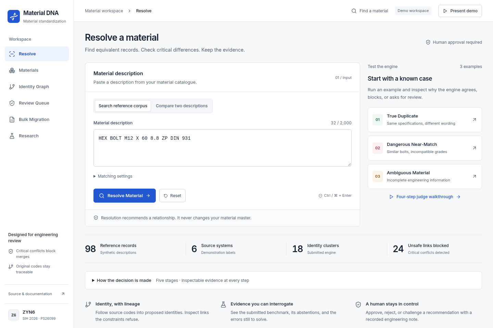

# Material DNA

An engineering review workspace for material-code harmonization across CPSE systems. Built by **ZYN6** for **SIH26099**.

[Live demonstrator](https://material-dna.vercel.app) · [Submission alignment](docs/SUBMISSION_ALIGNMENT.md) · [Validation](docs/UPGRADE_VALIDATION.md) · [Deployment](DEPLOYMENT.md)

Different descriptions can refer to the same material. Similar descriptions can also conceal incompatible grades, sizes or manufacturing processes. Material DNA extracts structured specifications, ranks candidate records, blocks detected critical conflicts and presents the evidence for a human decision.



## Workspace

| View           | Task                                                                                                                                                              |
| -------------- | ----------------------------------------------------------------------------------------------------------------------------------------------------------------- |
| Resolve        | Compare a description with the reference corpus or with a second description. Inspect the decision, relationship, code proposal, constraints and source evidence. |
| Materials      | Search the proposed canonical master and export its source mappings.                                                                                              |
| Identity Graph | Follow source lineage and inspect links withheld by engineering constraints.                                                                                      |
| Review Queue   | Record an approval, rejection or override; reopen a decided case with a reason and retained local history.                                                        |
| Bulk Migration | Import CSV/XLSX, resolve bounded batches, review decisions and roll back batch actions.                                                                           |
| Research       | Check submission claims, benchmark results, trade-offs and remaining validation needs.                                                                            |

Start the four-step walkthrough with **Present demo**, or visit `/?demo=1`. Use **True Duplicate**, **Dangerous Near-Match** and **Ambiguous Material** to demonstrate different outcomes. Nothing in Resolve automatically changes a material master.

## Run locally

Node.js 20+ is required; CI uses Node 24. No database or service key is needed for the default lexical workflow.

```bash
npm ci
npm run dev
```

For production:

```bash
npm run build
npm start
```

The interface uses a bundled, licensed Inter variable font, with no runtime font-service request. The default browser resolver uses lexical ranking. Optional server MiniLM ranking is available under **Matching settings**; results disclose whether dense inference actually ran. Unavailable models use lexical fallback.

## Validate

```bash
npm run lint
npm run typecheck
npm test -- --maxWorkers=2
npm run bench:check
npm run evaluate:policy
npm run build
npm exec -- playwright install chromium
npm run test:e2e -- --workers=2
```

For a container with Chromium installed, set `PLAYWRIGHT_CHROMIUM_EXECUTABLE_PATH=/usr/bin/chromium`. Set `BASE_URL` explicitly to verify an already running production build or an authorized deployment. Do not run `next dev` and `next build` simultaneously against the same `.next` directory.

CI runs lint, unit/API tests, the frozen lexical benchmark, policy-result reproducibility, a production build and the browser suite. [Validation details](docs/UPGRADE_VALIDATION.md) distinguish local checks, remote CI and deployment status.

## Evidence and scope

- The fixed PPT is unchanged. [The submission ledger](docs/SUBMISSION_ALIGNMENT.md) maps its claims to working behavior and identifies unsupported or historical claims.
- The reference corpus contains **98 synthetic records**, six source labels and 18 proposed master identities. It is not an official CPSE dataset.
- The submitted engine and its frozen benchmark remain available. The additional `review-first-v1` policy reduced false MATCH recommendations from 13 to zero on the same known 200-pair synthetic set, while automatic true-match coverage fell from 52% to 47%. This is a development comparison, not a holdout or a universal accuracy claim.
- The PPT's fused F1 **0.815** is a historical result. `bench:check` reproduces lexical scoring. Only `bench:check:embed` with real inference can reproduce the fused configuration.
- Code previews are deterministic proposals, not issued national identifiers. The original generator is retained; `identity-proposal-v2` includes extra explicit specifications and uses an eight-character hash. Registry collision checks and engineering approval remain necessary.
- The latest 100 review cases and five migration batches persist in browser-local storage. Exportable history is unsigned and is not shared institutional governance.
- Imports are limited to **3 MB / 1,000 rows**, resolved in **25-row** HTTP chunks. There is no SAP connector, shared database, authenticated reviewer or validated national-scale operation.

For independent evaluation, use the [pilot protocol](benchmark/PILOT_PROTOCOL.md) and the empty [expert review template](benchmark/expert-review-template.csv). No synthetic result establishes a competition score or selection probability.

## Repository map

```text
src/app/                    Pages, API routes, error recovery and global styles
src/components/             Workspace views and evidence controls
src/hooks/                  Resolver, review and migration state
src/lib/material-dna/       Extraction, normalization, matching, constraints and codes
src/lib/migration/          CSV/XLSX parsing and chunked resolution
src/lib/browser-workspace.ts Versioned local persistence
benchmark/                  Frozen outputs, reproducible comparison and pilot protocol
tests/                      Unit/API regressions and desktop/mobile browser checks
public/fonts/               Self-hosted Inter and its license
docs/                       Submission alignment, validation and screenshots
```

MIT licensed. Inter is distributed under its included SIL Open Font License.
